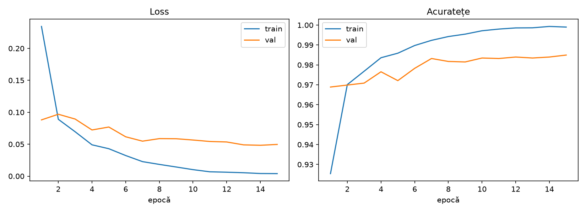

<h1 align="center">Forest Loss Detection</h1>

<p align="center">
  A first step toward detecting forest loss from satellite imagery:<br>
  CNNs in PyTorch (a small custom CNN and a pretrained ResNet18) that classify Sentinel-2 image patches by land-cover type.
</p>

<p align="center">
  
  
  
  
</p>

> **Status:** baseline experiment. The models recognize the `Forest` land-cover class on EuroSAT, but they do not yet detect deforestation or changes over time. See [Scope and roadmap](#scope-and-roadmap).

## Contents

- [Results](#results)
- [Dataset](#dataset)
- [Models and training](#models-and-training)
- [Running locally](#running-locally)
- [Project structure](#project-structure)
- [Scope and roadmap](#scope-and-roadmap)

## Results

Three runs were trained. The best checkpoint of each run was selected by validation macro F1, then evaluated once on the held-out test split (4,050 images).

| Model | Test loss | Test accuracy | Test macro F1 | Forest precision | Forest recall | Forest F1 |
| --- | ---: | ---: | ---: | ---: | ---: | ---: |
| SimpleCNN, 15 epochs | 0.119 | 96.0% | 0.959 | 0.982 | 0.998 | 0.990 |
| SimpleCNN, 30 epochs | 0.088 | 97.2% | 0.971 | 0.989 | 1.000 | 0.994 |
| **ResNet18 (pretrained), 15 epochs** | **0.034** | **98.8%** | **0.987** | **0.998** | **0.993** | **0.996** |

ResNet18 gave the best results on this split: 98.8% accuracy and 0.987 macro F1, with 49 misclassified patches out of 4,050, compared with 114 for the 30-epoch SimpleCNN. On the `Forest` class, ResNet18 has higher precision (0.998 vs 0.989) but slightly lower recall (447 of 450 patches vs 450 of 450); a difference of three images is within noise. The remaining errors are mostly between visually similar agriculture and vegetation classes (`AnnualCrop`, `PermanentCrop`, `HerbaceousVegetation`, `Pasture`).

ResNet18 differs from SimpleCNN in three ways at once (architecture, ImageNet pre-training, and 128 px input), so this comparison does not isolate which change helps most. All numbers come from single runs on a random split.

### Training curves

<table>
  <tr>
    <th align="center">SimpleCNN, 30 epochs</th>
    <th align="center">ResNet18, 15 epochs</th>
  </tr>
  <tr>
    <td align="center"></td>
    <td align="center"></td>
  </tr>
</table>

### Test confusion matrices

<table>
  <tr>
    <th align="center">SimpleCNN, 30 epochs</th>
    <th align="center">ResNet18, 15 epochs</th>
  </tr>
  <tr>
    <td align="center"></td>
    <td align="center"></td>
  </tr>
</table>

Plots for the 15-epoch SimpleCNN are in [`results/cnn_e15/`](results/cnn_e15/).

<details>
<summary><b>Per-class test metrics (ResNet18, 15 epochs)</b></summary>

| Class | Precision | Recall | F1 | Support |
| --- | ---: | ---: | ---: | ---: |
| AnnualCrop | 0.976 | 0.973 | 0.974 | 450 |
| Forest | 0.998 | 0.993 | 0.996 | 450 |
| HerbaceousVegetation | 0.980 | 0.991 | 0.986 | 450 |
| Highway | 0.989 | 0.997 | 0.993 | 375 |
| Industrial | 0.992 | 0.992 | 0.992 | 375 |
| Pasture | 0.974 | 0.980 | 0.977 | 300 |
| PermanentCrop | 0.976 | 0.968 | 0.972 | 375 |
| Residential | 0.996 | 0.996 | 0.996 | 450 |
| River | 0.995 | 0.984 | 0.989 | 375 |
| SeaLake | 1.000 | 1.000 | 1.000 | 450 |

</details>

<details>
<summary><b>Per-class test metrics (SimpleCNN, 30 epochs)</b></summary>

| Class | Precision | Recall | F1 | Support |
| --- | ---: | ---: | ---: | ---: |
| AnnualCrop | 0.947 | 0.956 | 0.951 | 450 |
| Forest | 0.989 | 1.000 | 0.994 | 450 |
| HerbaceousVegetation | 0.973 | 0.956 | 0.964 | 450 |
| Highway | 0.968 | 0.976 | 0.972 | 375 |
| Industrial | 0.981 | 0.984 | 0.983 | 375 |
| Pasture | 0.957 | 0.970 | 0.964 | 300 |
| PermanentCrop | 0.952 | 0.944 | 0.948 | 375 |
| Residential | 0.991 | 0.991 | 0.991 | 450 |
| River | 0.957 | 0.949 | 0.953 | 375 |
| SeaLake | 0.993 | 0.987 | 0.990 | 450 |

</details>

Full reports: [`cnn_e15`](results/cnn_e15/report_test.txt) · [`cnn_e30`](results/cnn_e30/report_test.txt) · [`resnet18_e15`](results/resnet18_e15/report_test.txt)

## Dataset

The data loader uses TorchVision's [EuroSAT](https://github.com/phelber/EuroSAT) dataset and downloads it to `data/` if it is not already present. It contains 27,000 RGB patches of 64 x 64 pixels from Sentinel-2, across 10 land-cover classes, including `Forest`.

| Split | Share | Images |
| --- | ---: | ---: |
| Train | 70% | 18,900 |
| Validation | 15% | 4,050 |
| Test | 15% | 4,050 |

The split is stratified and random (seed 42). Random horizontal and vertical flips are applied to training images only. Images are normalized with ImageNet statistics.

## Models and training

**SimpleCNN** (about 391k parameters): four convolutional blocks with 32, 64, 128, and 256 channels. Each block is a 3 x 3 convolution, batch normalization, ReLU, and 2 x 2 max pooling. Adaptive average pooling feeds a dropout layer (0.3) and a 10-class linear classifier. Trained from scratch on 64 x 64 px images.

**ResNet18** (about 11,18m parameters): TorchVision's ResNet18 with ImageNet pre-trained weights and the final layer replaced by a 10-class linear layer. All layers are fine-tuned. Images are resized to 128 x 128 px, and the learning rate is lower (`1e-4`).

**Shared training setup:**

| Setting | SimpleCNN | ResNet18 |
| --- | --- | --- |
| Loss | Cross-entropy | Cross-entropy |
| Optimizer | AdamW, weight decay `1e-4` | AdamW, weight decay `1e-4` |
| Learning rate | `1e-3` | `1e-4` |
| Schedule | Cosine annealing over the full run | Cosine annealing over the full run |
| Epochs | 15 and 30 | 15 |
| Input size | 64 x 64 | 128 x 128 |
| Batch size | 64 | 64 |
| Checkpoint | Best validation macro F1 | Best validation macro F1 |

## Running locally

Create and activate a virtual environment, then install the dependencies:

```bash
python -m venv .venv
source .venv/bin/activate
pip install -r requirements.txt
```

Train the runs:

```bash
python src/train.py --epochs 15 --name cnn_e15
python src/train.py --epochs 30 --name cnn_e30
python src/train.py --arch resnet18 --image-size 128 --epochs 15 --lr 1e-4 --name resnet18_e15
```

Evaluate a run (validation by default; use `--split test` only for the final report):

```bash
python src/evaluate.py --name cnn_e30 --split test
python src/evaluate.py --name resnet18_e15 --arch resnet18 --image-size 128 --split test
```

Reports and plots are written to `results/<run-name>/`.

The `Makefile` provides shorter commands:

```bash
make train EPOCHS=30      # SimpleCNN in the foreground
make resnet               # ResNet18 in the background (logs in logs/)
make eval NAME=cnn_e30    # evaluate on validation
make resnet-eval          # evaluate ResNet18 on validation
make test NAME=cnn_e30    # evaluate on test (asks for confirmation)
make status               # progress of a running training
make help                 # list all commands
```

## Project structure

```text
src/
  dataset.py   EuroSAT loading, transforms, and train/validation/test splits
  model.py     SimpleCNN and ResNet18 builders
  train.py     Training loop and best-checkpoint saving
  evaluate.py  Metrics, classification reports, and plots
scripts/       Helper scripts (training status)
checkpoints/   Training histories and saved model checkpoints
results/       Reports, confusion matrices, and training curves
Makefile       Shortcuts for training and evaluation
```

## Scope and roadmap

This is a baseline for classifying individual satellite image patches. It does not compare images from different dates, identify when forest cover was lost, or determine whether a change was caused by logging, fire, or another event. It cannot establish whether any activity was legal.

The random split is useful for an initial baseline, but patches from the same scene can end up in both training and test sets, so it does not measure how well the models generalize to new locations.

**Roadmap**

- [x] Baseline CNN on EuroSAT RGB with train/validation/test evaluation
- [x] Compare against a pretrained ResNet18
- [ ] Build a custom dataset from Sentinel-2 imagery and Hansen Global Forest Change labels
- [ ] Add the near-infrared band and NDVI as input
- [ ] Split by geographic area instead of randomly
- [ ] Detect change between imagery from different years