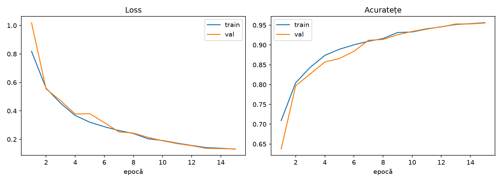
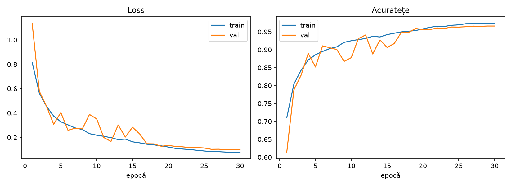
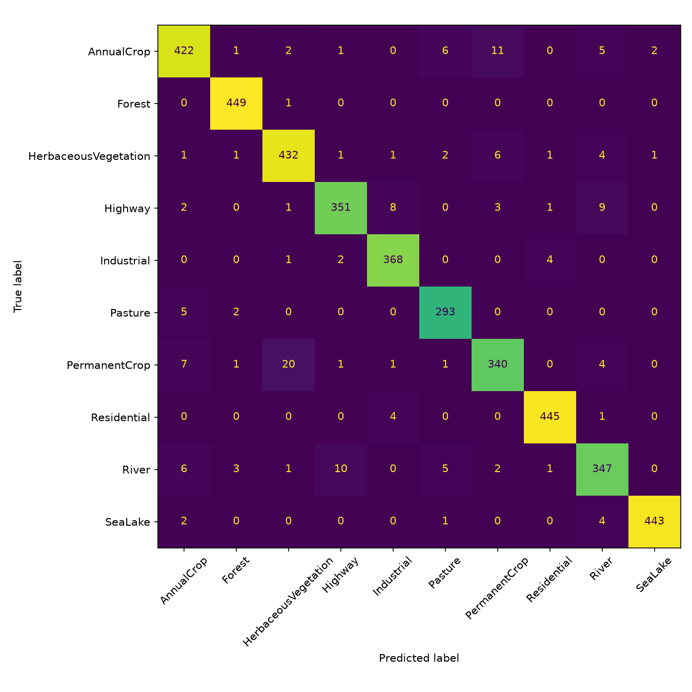
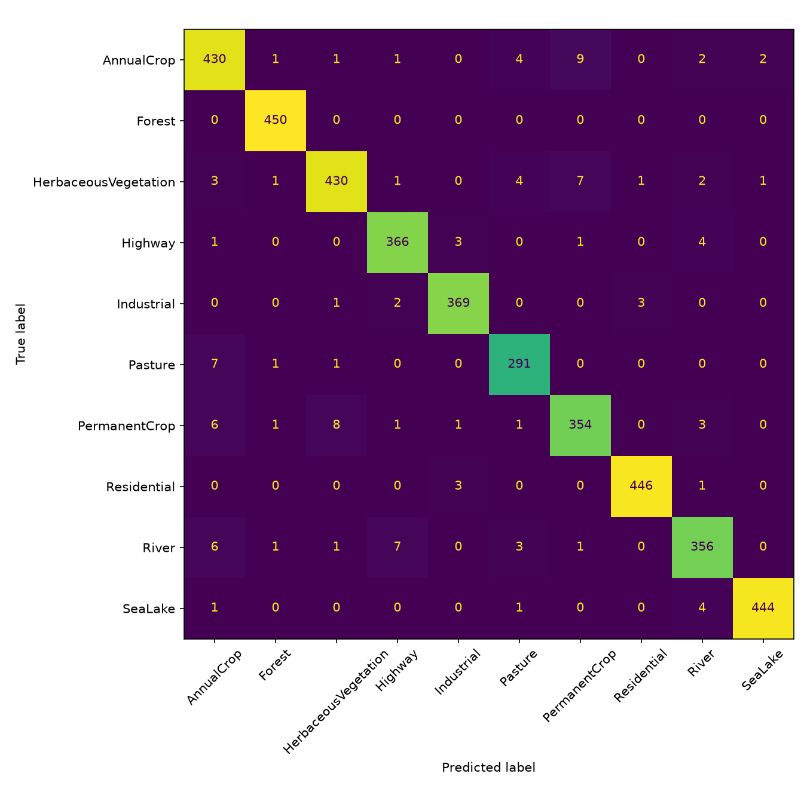

<h1 align="center">Forest Loss Detection</h1>

<p align="center">
  A first step toward detecting forest loss from satellite imagery:<br>
  a CNN in PyTorch that classifies Sentinel-2 image patches by land-cover type.
</p>

<p align="center">
  
  
  
  
</p>

> **Status:** baseline experiment. The model recognizes the `Forest` land-cover class on EuroSAT, but it does not yet detect deforestation or changes over time. See [Scope and roadmap](#scope-and-roadmap).

## Contents

- [Results](#results)
- [Dataset](#dataset)
- [Model and training](#model-and-training)
- [Running locally](#running-locally)
- [Project structure](#project-structure)
- [Scope and roadmap](#scope-and-roadmap)

## Results

The model was trained for 15 and 30 epochs. The best checkpoint of each run was selected by validation macro F1, then evaluated once on the held-out test split (4,050 images).

| Training run | Test loss | Test accuracy | Test macro F1 | Forest precision | Forest recall | Forest F1 |
| --- | ---: | ---: | ---: | ---: | ---: | ---: |
| 15 epochs | 0.119 | 96.0% | 0.959 | 0.982 | 0.998 | 0.990 |
| **30 epochs** | **0.088** | **97.2%** | **0.971** | **0.989** | **1.000** | **0.994** |

The 30-epoch run performed better on this split, including on the `Forest` class (450 of 450 forest patches classified correctly). Most remaining errors are between visually similar vegetation and agriculture classes (`AnnualCrop`, `PermanentCrop`, `HerbaceousVegetation`, `Pasture`) and between `River` and `Highway`.

### Training curves

<table>
  <tr>
    <th align="center">15 epochs</th>
    <th align="center">30 epochs</th>
  </tr>
  <tr>
    <td align="center"></td>
    <td align="center"></td>
  </tr>
</table>

### Test confusion matrices

<table>
  <tr>
    <th align="center">15 epochs</th>
    <th align="center">30 epochs</th>
  </tr>
  <tr>
    <td align="center"></td>
    <td align="center"></td>
  </tr>
</table>

<details>
<summary><b>Per-class test metrics (30 epochs)</b></summary>

| Class | Precision | Recall | F1 | Support |
| --- | ---: | ---: | ---: | ---: |
| AnnualCrop | 0.947 | 0.956 | 0.951 | 450 |
| Forest | 0.989 | 1.000 | 0.994 | 450 |
| HerbaceousVegetation | 0.973 | 0.956 | 0.964 | 450 |
| Highway | 0.968 | 0.976 | 0.972 | 375 |
| Industrial | 0.981 | 0.984 | 0.983 | 375 |
| Pasture | 0.957 | 0.970 | 0.964 | 300 |
| PermanentCrop | 0.952 | 0.944 | 0.948 | 375 |
| Residential | 0.991 | 0.991 | 0.991 | 450 |
| River | 0.957 | 0.949 | 0.953 | 375 |
| SeaLake | 0.993 | 0.987 | 0.990 | 450 |

Full reports: [`cnn_e15`](results/cnn_e15/report_test.txt) · [`cnn_e30`](results/cnn_e30/report_test.txt)

</details>

## Dataset

The data loader uses TorchVision's [EuroSAT](https://github.com/phelber/EuroSAT) dataset and downloads it to `data/` if it is not already present. It contains 27,000 RGB patches of 64 x 64 pixels from Sentinel-2, across 10 land-cover classes, including `Forest`.

| Split | Share | Images |
| --- | ---: | ---: |
| Train | 70% | 18,900 |
| Validation | 15% | 4,050 |
| Test | 15% | 4,050 |

The split is stratified and random (seed 42). Random horizontal and vertical flips are applied to training images only. Images are normalized with ImageNet statistics.

## Model and training

**Architecture** (`SimpleCNN`, about 391k parameters): four convolutional blocks with 32, 64, 128, and 256 channels. Each block is a 3 x 3 convolution, batch normalization, ReLU, and 2 x 2 max pooling. Adaptive average pooling feeds a dropout layer (0.3) and a 10-class linear classifier.

**Training:**

| Setting | Value |
| --- | --- |
| Loss | Cross-entropy |
| Optimizer | AdamW (learning rate `1e-3`, weight decay `1e-4`) |
| Schedule | Cosine annealing over the full run |
| Batch size | 64 |
| Checkpoint | Best validation macro F1 |

## Running locally

Create and activate a virtual environment, then install the dependencies:

```bash
python -m venv .venv
source .venv/bin/activate
pip install -r requirements.txt
```

Train the 15- and 30-epoch runs:

```bash
python src/train.py --epochs 15 --name cnn_e15
python src/train.py --epochs 30 --name cnn_e30
```

Evaluate a run (validation by default; use `--split test` only for the final report):

```bash
python src/evaluate.py --name cnn_e30 --split test
```

Reports and plots are written to `results/<run-name>/`.

The `Makefile` provides shorter commands:

```bash
make train EPOCHS=30      # train in the foreground
make eval NAME=cnn_e30    # evaluate on validation
make test NAME=cnn_e30    # evaluate on test (asks for confirmation)
make help                 # list all commands
```

## Project structure

```text
src/
  dataset.py   EuroSAT loading, transforms, and train/validation/test splits
  model.py     SimpleCNN architecture
  train.py     Training loop and best-checkpoint saving
  evaluate.py  Metrics, classification reports, and plots
checkpoints/   Training histories and saved model checkpoints
results/       Reports, confusion matrices, and training curves
Makefile       Shortcuts for training and evaluation
```

## Scope and roadmap

This is a baseline for classifying individual satellite image patches. It does not compare images from different dates, identify when forest cover was lost, or determine whether a change was caused by logging, fire, or another event. It cannot establish whether any activity was legal.

The random split is useful for an initial baseline, but patches from the same scene can end up in both training and test sets, so it does not measure how well the model generalizes to new locations.

**Roadmap**

- [x] Baseline CNN on EuroSAT RGB with train/validation/test evaluation
- [ ] Compare against a pretrained ResNet18
- [ ] Build a custom dataset from Sentinel-2 imagery and Hansen Global Forest Change labels
- [ ] Add the near-infrared band and NDVI as input
- [ ] Split by geographic area instead of randomly
- [ ] Detect change between imagery from different years