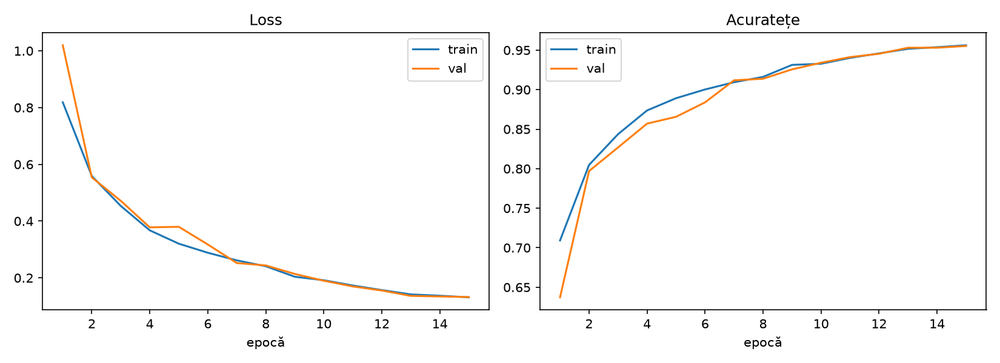
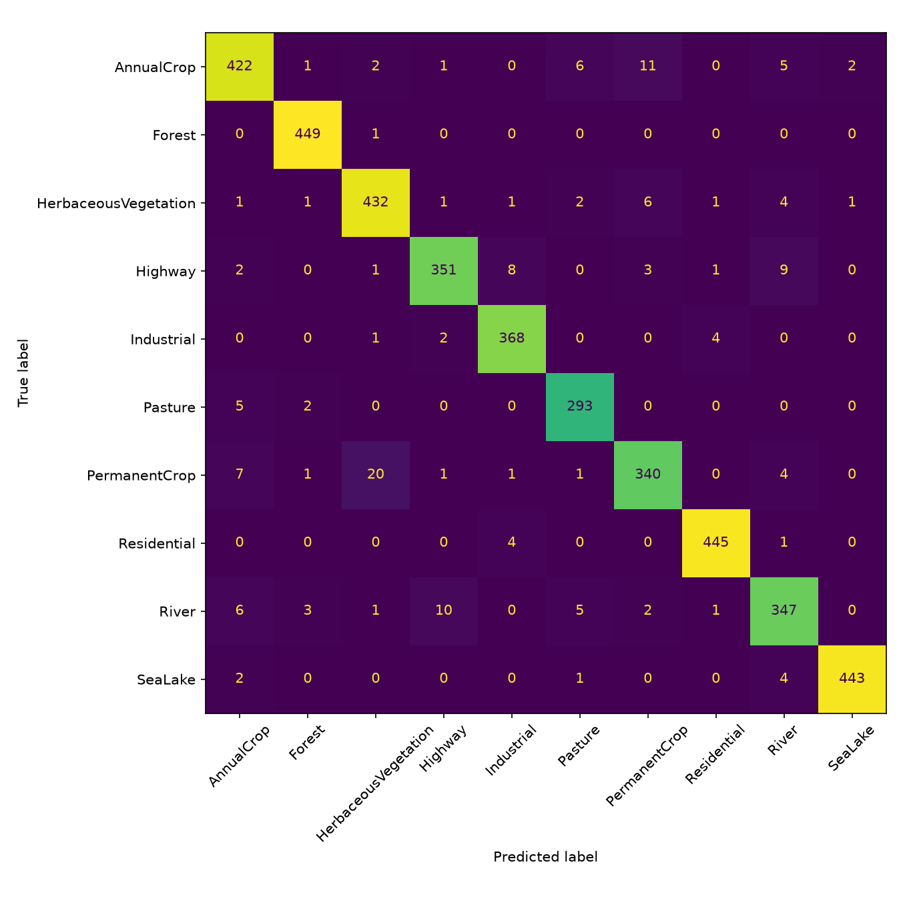
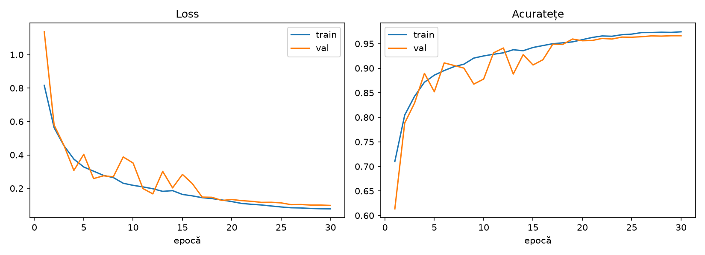
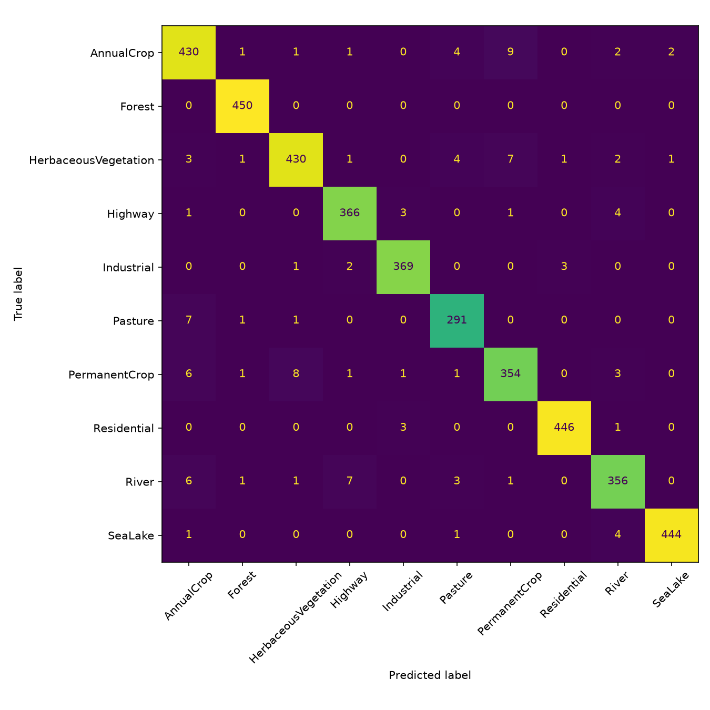

# Forest Loss Detection

A first step toward detecting forest loss from satellite imagery. This project trains a simple convolutional neural network (CNN) in PyTorch to classify satellite image patches by land-cover type.

The current experiment uses EuroSAT, a Sentinel-2 satellite image dataset. It is a land-cover classification baseline: it can recognize the `Forest` class, but it does not yet detect deforestation or changes over time.

## Results

The model was trained for 15 and 30 epochs. The best checkpoint from each run was selected using validation macro F1, then evaluated on the held-out test split.

| Training run | Test loss | Test accuracy | Test macro F1 | Forest precision | Forest recall | Forest F1 |
| --- | ---: | ---: | ---: | ---: | ---: | ---: |
| 15 epochs | 0.119 | 96.0% | 0.959 | 0.982 | 0.998 | 0.990 |
| 30 epochs | 0.088 | 97.2% | 0.971 | 0.989 | 1.000 | 0.994 |

Each test split contains 4,050 images. The 30-epoch run performed better on this split, including on the `Forest` class.

### 15-epoch run





### 30-epoch run





Detailed per-class metrics are available in [`results/cnn_e15/report_test.txt`](results/cnn_e15/report_test.txt) and [`results/cnn_e30/report_test.txt`](results/cnn_e30/report_test.txt).

## Dataset

The data loader uses TorchVision's EuroSAT dataset and downloads it to `data/` if it is not already present. The images are RGB patches of 64 x 64 pixels across 10 land-cover classes, including `Forest`.

The data is split into training, validation, and test sets using a stratified random split of 70% / 15% / 15%, with seed 42. Random horizontal and vertical flips are applied to training images only.

## Model and training

The CNN has four convolutional blocks with 32, 64, 128, and 256 channels. Each block uses a 3 x 3 convolution, batch normalization, ReLU, and max pooling. Adaptive average pooling feeds a dropout layer and a 10-class linear classifier.

Training uses cross-entropy loss, the AdamW optimizer, and a cosine learning-rate schedule. The default learning rate is `0.001`, weight decay is `0.0001`, and batch size is `64`. The checkpoint with the best validation macro F1 is saved for each run.

## Running locally

Create and activate a virtual environment, then install the project dependencies:

```bash
python -m venv .venv
source .venv/bin/activate
pip install -r requirements.txt
```

Train the 15- and 30-epoch runs:

```bash
python src/train.py --epochs 15 --name cnn_e15
python src/train.py --epochs 30 --name cnn_e30
```

Evaluate a run on the test split (replace the run name to evaluate a different checkpoint):

```bash
python src/evaluate.py --name cnn_e30 --split test
```

Evaluation reports are written to `results/<run-name>/`. Use `--split val` to evaluate on the validation split instead.

## Project structure

```text
src/
  dataset.py   EuroSAT loading, transforms, and train/validation/test splits
  model.py     SimpleCNN architecture
  train.py     Training loop and best-checkpoint saving
  evaluate.py  Metrics, classification reports, and plots
checkpoints/   Training histories and saved model checkpoints
results/       Reports, confusion matrices, and training curves
```

## Current scope and next steps

This is a baseline for classifying individual satellite image patches. It does not compare images from different dates, identify when forest cover was lost, or determine whether a change was caused by logging, fire, or another event. It cannot establish whether any activity was legal.

The next step is to build a dataset for actual change detection, using imagery from different dates and forest-loss labels. That will require aligning imagery and labels, handling clouds, and evaluating on geographically separate areas. The current random split is useful for an initial baseline, but it does not measure how well the model generalizes to new locations.
